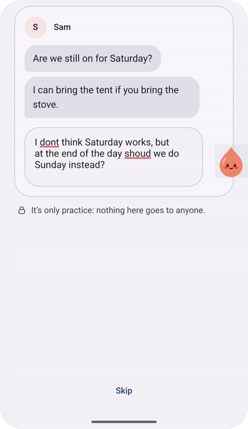
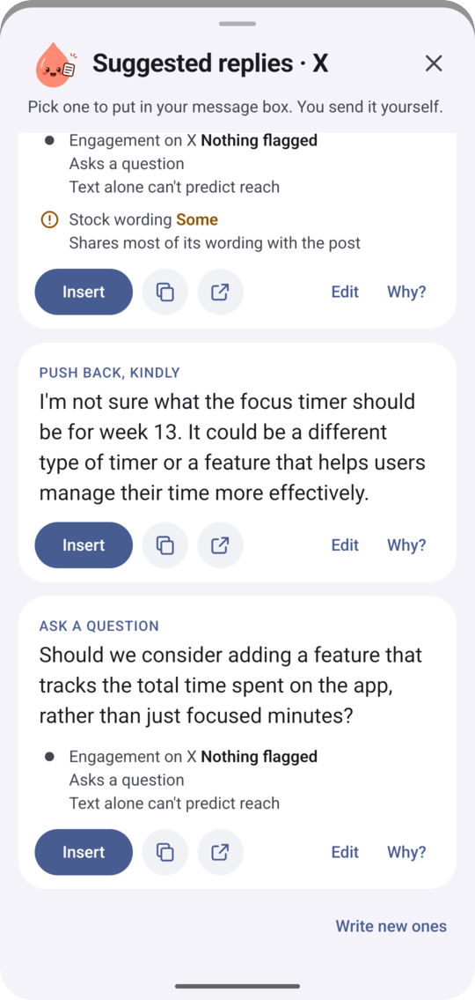
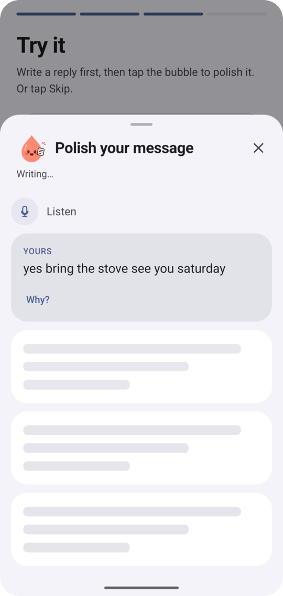
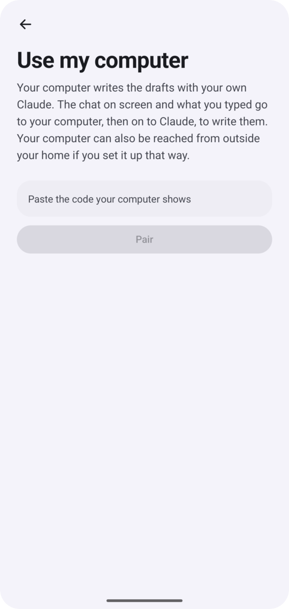

<div align="center">


<h1>Ownvoice</h1>

<strong>Tap the bubble. Pick the tidier version. Send it yourself.</strong>

A small coral bubble sits beside the message box in your Android chats. Tap it for cleaner,
shorter or friendlier versions of your own words, written on your phone or by the AI plan you
already pay for.

<picture>
  <source media="(max-width: 600px) and (prefers-color-scheme: dark)" srcset="docs/readme/hero-phone-dark.webp" />
  <source media="(max-width: 600px)" srcset="docs/readme/hero-phone-light.webp" />
  <source media="(prefers-color-scheme: dark)" srcset="docs/readme/hero-dark.webp" />
  
</picture>

</div>

<div align="center">

[Download for Android](https://github.com/umeranjum17/ownvoice/releases/latest/download/Ownvoice.apk) ·
[Quick start](#quick-start) ·
[User guide](docs/readme/guide.md) ·
[All releases](https://github.com/umeranjum17/ownvoice/releases)

[](https://github.com/umeranjum17/ownvoice/releases/latest)

<a href="LICENSE"></a>

</div>

## Quick start

1. **Install it.** On your Android phone, tap **Download for Android** above, then open the file and install. Android may ask you to allow installing from this source.
2. **Say how it writes.** Open Ownvoice and pick **On this phone** (private, free, works without internet), or your own ChatGPT, Claude, OpenRouter or OpenCode Go. Then tap **Turn on** and switch on **Use Ownvoice**.
3. **Use it in a chat.** Write your reply, tap the coral bubble, and pick the version you like. You press Send.

From a terminal, the same install:

```sh
adb install -r Ownvoice.apk
```

<details>
<summary>Android says the app was denied access, or the switch is greyed out?</summary>

Android 13 and later blocks it for apps installed outside Google Play, and setup shows the way past it: tap the greyed **Ownvoice** row once and close Android's message, then in Ownvoice tap **Open App info**, tap **⋮** at the top right, choose **Allow restricted settings**, and come back to tap **Turn on**. On OPPO, OnePlus or Realme phones, also add Ownvoice to the security app's allowlist ([how](docs/readme/guide.md#download-and-install)).

Step-by-step help for every screen is in the [user guide](docs/readme/guide.md#get-started).
</details>

## Why Ownvoice

| | Doing it by hand | With Ownvoice |
| --- | --- | --- |
| Catching slips | Read it again, and miss the "shoud" anyway | The panel marks the slip and offers the fix |
| Trimming filler | Delete, retype, delete again | **Shorter** gives back the same points in fewer words |
| Asking a chatbot to rewrite | Copy out, paste in, copy back, paste in | Never leaves the chat: **Insert** puts it in your box |
| What it costs | A writing tool per seat, per month | Free on your phone, or the plan you already pay for |
| What leaves your phone | — | Nothing, with **On this phone**. Nothing is sent unless you tap |

- **It never sends, posts or taps anything for you.** You read the version and press Send.
- **It only reads when you tap.** The bubble shows in the apps you switch on, and **What Ownvoice read** lists every tap, without your text.
- **It writes with what you already have.** Your phone, or the ChatGPT, Claude, OpenRouter or OpenCode Go plan you pay for, or the Claude on your own computer.

<p align="center">
  <picture>
    <source media="(prefers-color-scheme: dark)" srcset="docs/readme/panel-loop-dark.webp" />
    
  </picture><br />
  <sub>A real run in the practice chat: it writes, then hands you a tidied line and a shorter one.</sub>
</p>

## What you get

<table>
  <tr>
    <td align="center" width="50%">
      <picture>
        <source media="(prefers-color-scheme: dark)" srcset="docs/readme/polish-dark.webp" />
        
      </picture>
      <br /><strong>Polish what you wrote</strong><br />Fix slips. Trim filler with Shorter.
    </td>
    <td align="center" width="50%">
      
      <br /><strong>Reply ideas on X</strong><br />Cards rated for the platform.
    </td>
  </tr>
  <tr>
    <td align="center" width="50%">
      <picture>
        <source media="(prefers-color-scheme: dark)" srcset="docs/readme/rewrite-dark.webp" />
        
      </picture>
      <br /><strong>Make any text better</strong><br />Select text, choose Ownvoice.
    </td>
    <td align="center" width="50%">
      
      <br /><strong>Speak instead of typing</strong><br />Tap Listen and talk.
    </td>
  </tr>
  <tr>
    <td align="center" width="50%">
      <picture>
        <source media="(prefers-color-scheme: dark)" srcset="docs/readme/writer-dark.webp" />
        
      </picture>
      <br /><strong>Choose who writes</strong><br />On your phone, or your own plan.
    </td>
    <td align="center" width="50%">
      
      <br /><strong>Use my computer</strong><br />Your computer's Claude writes.
    </td>
  </tr>
</table>

It also learns the words you never say and how you like to write, turns raw notes into posts, and
follows your phone's colours, font, light and dark ([every screen](docs/readme/guide.md#everything-in-one-place)).

## Proof

Ownvoice is new, so there are no quotes or customer logos to show you yet. Here is what you can check yourself today.

| What | Where to check it |
| --- | --- |
| Eleven releases in 24 days, v1.0.2 on 1 Oct 2026 to v1.0.10 on 24 Oct 2026 | [All releases](https://github.com/umeranjum17/ownvoice/releases) |
| Every release ships `Ownvoice.apk` next to its `Ownvoice.apk.sha256`, so you can check the file you installed | [v1.0.10](https://github.com/umeranjum17/ownvoice/releases/tag/v1.0.10) |
| A model or prompt change has to pass the writer evaluation gate: the cases P01, P13, S05, R01, R07, R13, R14, P20 and N01 | [mobile/eval](mobile/eval/README.md) |
| The writing core is published as a package you can use: `ownvoice-engine` 0.2.0, on npm since 22 Oct 2026 | [npm](https://www.npmjs.com/package/ownvoice-engine) |
| Every screenshot on this page is an unedited capture of the real app, on a demo phone with demo text | [docs/readme](docs/readme) |

Rerun the gate yourself from a copy of this repo:

```sh
cd mobile/eval && EVAL_BACKEND=codex-cli ONLY=P01,P13,S05,R01,R07,R13,R14,P20,N01 \
  node run.ts gate http://unused out/gate.json && node score.ts out/gate.json
```

With a local model server the same command runs the phone writer itself; the backend above runs the
same prompts and admission checks on a hosted writer. [How the eval works](mobile/eval/README.md).

## Known limits

<a id="reply-ideas-are-unavailable-for-now"></a>

**Reply ideas need something to reply to.** An empty box over a readable post on X, LinkedIn, Reddit,
Threads or Bluesky offers reply cards, each rated for that platform. A post with no text to ground on,
an image-only post, or a screen with nothing readable above the box, shows the plain note **Reply ideas
are unavailable for now.** and nothing is invented. In Gmail, tap the bubble on an open email to get
reply ideas; **Reply** on a card opens Gmail's reply with it in the box, and you press Send. Other chats
keep the withhold for now ([details](docs/readme/guide.md#reply-ideas)).

**The phone writer needs room.** If your phone needs the one-time writing download, it is about 2 to 3 GB,
once, on Wi-Fi, and only after you say yes. **Free up space** in **How Ownvoice writes** deletes it again.

**Chats polish, feeds reply.** In a chat, tapping the bubble improves what you already wrote. Reply cards
come from feed apps with a readable post above the box.

## More

- 📖 [User guide](docs/readme/guide.md): every screen and every check, in detail
- 🧭 [Vision](VISION.md): who Ownvoice is for and where it is going
- 🌱 <a id="your-growth"></a>[Your growth](docs/readme/guide.md#your-growth): keep track on your phone
- 🛠️ [Android app](mobile/README.md): build it, test it, and how it writes
- 🧩 [Writing core](packages/engine/README.md) and its [quality gate](mobile/eval/README.md)
- 🎨 [Icons](docs/icons/README.md) · 📦 [All releases](https://github.com/umeranjum17/ownvoice/releases)
- The original Kotlin app lives in [app/](app/README.md)

## Contributing

Issues and pull requests are welcome. Build and device checks are in [mobile/README.md](mobile/README.md#android-build-and-device-checks);
the writing core builds and tests on its own, see [packages/engine](packages/engine/README.md#development-and-release).

Apache-2.0. See [LICENSE](LICENSE).
