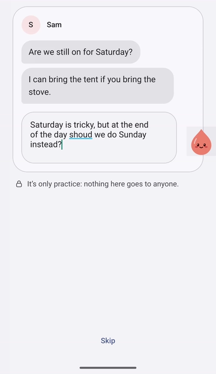
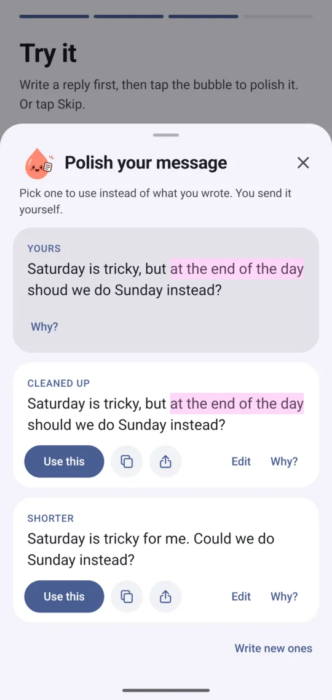
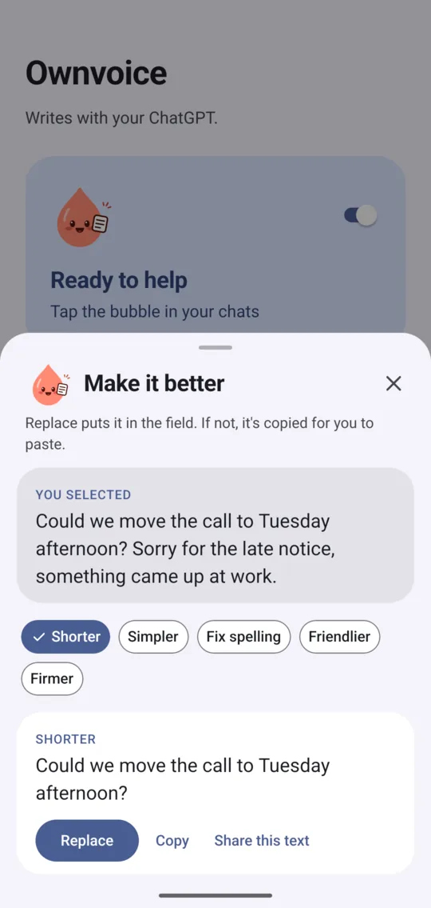
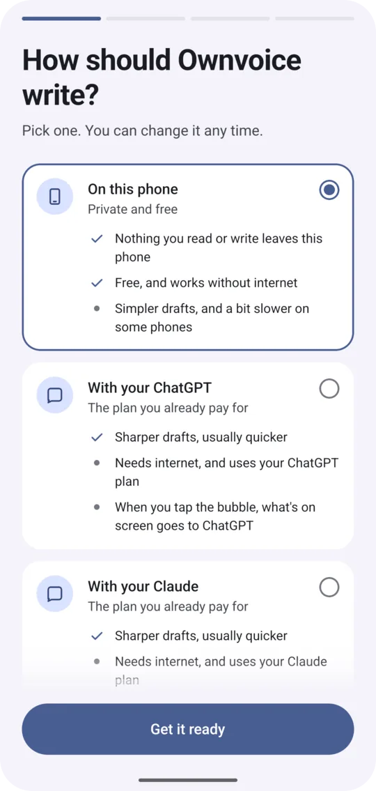
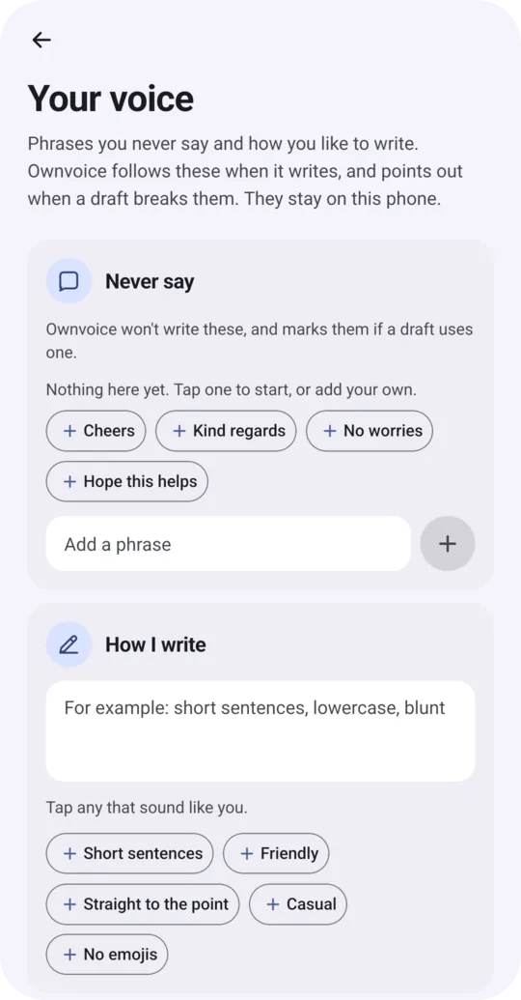

  

<h1 align="center">Ownvoice</h1>

  <strong>Sound like yourself, just a little better.</strong> 
  A little bubble. Cleaner words. Right in your chats.

  
  
  

  

  <picture>
    <source media="(prefers-color-scheme: dark)" srcset="docs/readme/hero-dark.webp" />
    
  </picture> 
  Spelling fixed. Filler trimmed in <strong>Shorter</strong>.

## Why Ownvoice

You know what you want to say. Sometimes it just needs a little tidying. Ownvoice stays where you write, spots tired phrases, and offers cleaner versions of your words. Pick one you like. You always press Send yourself.

## See it

<table>
  <tr>
    <td align="center" width="50%">
      <picture>
        <source media="(prefers-color-scheme: dark)" srcset="docs/readme/polish-dark.webp" />
        
      </picture>
       <strong>Polish what you wrote</strong> Fix slips. Trim filler with Shorter.
    </td>
    <td align="center" width="50%">
      <picture>
        <source media="(prefers-color-scheme: dark)" srcset="docs/readme/rewrite-dark.webp" />
        
      </picture>
       <strong>Make any text better</strong> Select text, choose Ownvoice.
    </td>
  </tr>
  <tr>
    <td align="center" width="50%">
      <picture>
        <source media="(prefers-color-scheme: dark)" srcset="docs/readme/writer-dark.webp" />
        
      </picture>
       <strong>Choose who writes</strong> On your phone, or your own plan.
    </td>
    <td align="center" width="50%">
      <picture>
        <source media="(prefers-color-scheme: dark)" srcset="docs/readme/voice-dark.webp" />
        
      </picture>
       <strong>Teach it your voice</strong> Words and habits that feel like you.
    </td>
  </tr>
</table>

## Quick start

1. **Get the app.** On your Android phone, [download Ownvoice](https://github.com/umeranjum17/ownvoice/releases/latest/download/Ownvoice.apk), then tap **Open** and **Install**.
2. **Allow the bubble.** Open Ownvoice, choose how it writes, then tap **Turn on** and switch on **Use Ownvoice**.
3. **Try it in a chat.** Start with the practice chat, then choose where the bubble shows. Write a reply, tap the bubble, and pick the version you like.

Switch greyed out? Open Ownvoice's **App info**, tap **⋮**, choose **Allow restricted settings**, and try again. On OPPO, OnePlus or Realme phones, also add Ownvoice to the security app's allowlist ([how](docs/readme/guide.md#download-and-install)). Step-by-step help is in the [user guide](docs/readme/guide.md#get-started).

Want to build it yourself? See [Build and run](mobile/README.md#android-build-and-device-checks).

## What it does

- ✨ **Polishes in place.** Marks stock phrases and fixes clear slips like "shoud" or "dont".
- ✂️ **Rewrites any selection.** Shorter, simpler, friendlier or firmer, from any app.
- 🔒 **Your choice of writer.** Private, free and offline on supported phones, or with your own AI plan or OpenRouter key.
- 🗣️ **Learns your voice.** Your never-say list and writing rules shape every draft.
- 👀 **Honest about every draft.** Plain notes on what it checked, never a score to chase.
- 📱 **Only where you want it.** Pick the apps that show the bubble, or pause it any time.
- 🌗 **Feels like your phone.** Your colours, your font, light and dark.

## Your words stay yours

- Ownvoice reads the screen **when you tap the bubble**, only in apps you switched on. Optional spelling help also checks your message as you type, on your phone.
- It **never sends, posts or taps anything** for you.
- With the phone writer, your words stay on your phone. With your own plan or OpenRouter key, text goes there when you ask for help.
- **What Ownvoice read** lists every tap (never your text), and **Wipe everything** clears it all.

Full details: [Your words stay yours](docs/readme/guide.md#your-words-stay-yours).

## Known limits

Reply ideas work when the post can be read: an empty box over a readable post on X, LinkedIn, Reddit, Threads or Bluesky offers reply cards, each rated for that platform. A post with no text to ground on — an image-only post, a screen with nothing readable above the box — shows the plain note **Reply ideas are unavailable for now.** and nothing is invented. Chats and mail keep the withhold for now ([details](docs/readme/guide.md#reply-ideas)).

## Learn more

- 📖 [User guide](docs/readme/guide.md): every screen and check in detail
- 🌱 [Your growth](docs/readme/guide.md#your-growth): keep track on your phone
- 🛠️ [Android app](mobile/README.md): build, checks and how Ownvoice writes
- 🧩 [Writing core](packages/engine/README.md) and its [quality gate](mobile/eval/README.md)
- 🎨 [Icons](docs/icons/README.md) · 🤖 [Agent notes](AGENTS.md) · 📦 [All releases](https://github.com/umeranjum17/ownvoice/releases)
- The original Kotlin app lives in [app/](app/README.md).

## License

Apache-2.0. See [LICENSE](LICENSE).
