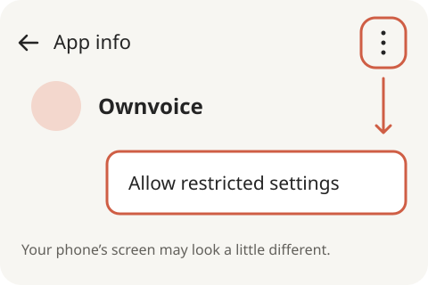
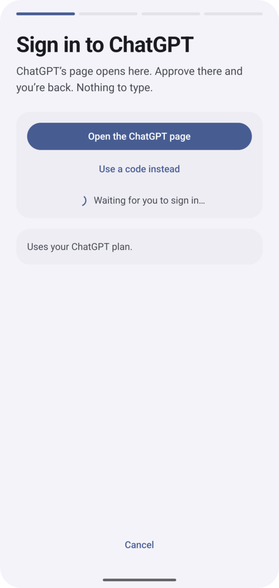

# Ownvoice user guide

The full detail behind the [README](../../README.md): every screen, every check and every known limit of the current build (1.0.7).

## Reply ideas

An empty message box over a readable post on a recognized feed app (X, LinkedIn, Reddit, Threads, Bluesky, including in Chrome when its address bar identifies the site) offers reply cards. The panel grounds them on the post block the screen shows above the box; the cards, their ratings and the length checks follow that platform. A blank composer with nothing to answer asks for the one line instead (see [Start a post from a blank composer](#start-a-post-from-a-blank-composer)). When nothing readable sits above the box — an image-only post, a compose screen with only labels — the panel shows **Reply ideas are unavailable for now. Write your reply first, then tap the bubble to polish it.** instead: no reply is generated, streamed, retried or offered to copy or insert. Chats keep this same withhold.

In Gmail, open the email you want to answer and tap the bubble there. The panel reads the open thread and offers three replies: **Accept**, **Say no, kindly** and **Ask first**. **Reply** on a card opens Gmail's own reply to the newest mail with that reply in the box; you read it over and press Send yourself. If Gmail's reply doesn't open, the reply is copied for you to paste. Tapped anywhere else in Gmail, such as the inbox, the panel says **Open the email you want to answer, then tap the bubble for reply ideas.** and writes nothing. In Gmail's own reply screen the original mail isn't shown, so tap the bubble on the thread, not there; text you already typed there is polished as usual.

Your voice notes describe style, not facts. Names in polished drafts keep their own check, which this release did not rerun.

## Polish what you wrote

On X, LinkedIn and Reddit, the panel names the platform beside its heading. A new post you typed shows **Polish your post · X** or **Polish your post · Reddit**. A reply you started under a post shows **Suggested replies · X** (or **· Reddit**), or names the person instead — **Reply to Sam · X** — when one name appears more than once in the messages above: your text stays as **Yours**, and the suggestions build on your point, best fit first. This works in their Android apps and in Chrome when its address bar identifies the site. Replies and versions use that platform’s writing rules and length checks. Other apps keep their existing headings. While Ownvoice reads the screen, the heading says **Writing…**.

Already typed something? The same tap shows your text with the stock phrases marked, then a few better versions of it. Real words in other languages are not rejected just because the phone's English dictionary does not recognize them; if no usable version is found, the writer checks whether the text is keyboard mash before declining it. **Use this** swaps your text for one of them. **Cleaned up** fixes clear spelling slips, clear missing apostrophes such as “dont”, accidental repeats of “the”, “a” or “an” starting with a lowercase copy, and “Its” before “a”, “an” or “the”. For example, “Its a good plan, I shoud be there by the the evening.” becomes “It's a good plan, I should be there by the evening.” This card uses only your own text and those clear fixes; the on-phone writer makes its other versions from what you typed, not unrelated screen text. Other suspected slips appear under **Check these** when spelling checks are on; each has its own **Fix**. When no different version is found, Ownvoice keeps your text and asks you to read it over before sending. That does not approve the writing.

## Start a post from a blank composer

On X, LinkedIn, Reddit and the other feed apps, tapping the bubble in an **empty** composer shows **Start your post** and asks for one line: write what the post is about, then tap the bubble again.

Nothing in an empty composer says what you want to write, so Ownvoice does not guess a topic and does not hand you a question to post in your place. Write one line — a note, a result, a thing you changed — and it drafts the post from that line in your own voice and your writing rules. From there it is the same panel as anywhere else: **Edit** changes the text, the checks follow your edit, and **Use this** puts exactly your text in the composer. You write the post and press Post yourself. Chat and mail composers are unaffected: they keep the empty state and the reply rules above.

## Honest about every draft

A draft shows no verdict until all the deeper checks have run. Even then, Ownvoice leaves approval blank because the wording has not been fully checked; it does not call a draft “Sounds natural”. Concerns can still appear, such as “Check the wording” or “A bit stock: 3 phrases you could say more simply”. When every suggested draft has the same verdict, the repeated sentence is left off.

**Why?** on your original text or a suggested draft lists stock phrases, whether it says something real, whether it fits the chat and whether it makes anything up separately, each with a reason or a note that the check has not run. Possible slips get their own warning; otherwise a separate wording row says the wording has not been fully checked. Ticks mark passing checks, warnings mark concerns, and a dash marks an unchecked item. Each draft also names its tone in a word or two, such as “Sounds friendly”. There is no score to chase.

## Make any text better

Select text in any app, choose **Ownvoice** from the selection menu (or share the text to Ownvoice), and pick **Shorter**, **Simpler**, **Fix spelling**, **Friendlier** or **Firmer**. **Copy** copies the version, then paste it where you like, or **Share this text** to choose where it goes. If a new version adds a time, a number or a fact you didn't write, it says **Check this**, and **Copy** and **Share this text** stay disabled while it shows. This works without the bubble's permission.

## Speak instead of typing

In the panel, tap the mic to listen, speak, then tap **Stop listening** (or go quiet, and Ownvoice finishes on its own). The words you said go into the field you were writing in, the same way **Insert** does. Recognition runs on this phone only. The first tap asks for the microphone; if this phone is missing its speech language pack, the phone's own download prompt appears first. When this phone can't listen in your language, or the microphone is refused, the panel says so.

## Your choice of writer

Pick who writes your drafts, and change it any time. **On this phone** is private and free: nothing you read or write leaves the phone, and it works without internet. Phones that need it get a one-time download of about 2 to 3 GB, on Wi-Fi, and only after you say yes. **With your ChatGPT** and **With your Claude** use the plan you already pay for: sharper and usually quicker, but what's on screen goes to that service when you tap the bubble. **With your OpenRouter** uses a key you paste in, billed by OpenRouter as you use it; it appears only when the phone can use it. **With your OpenCode Go** uses the key your OpenCode Go plan gave you, billed as that plan rather than per use; it appears only when the phone can use it. **Use my computer** (on Home) writes with the Claude you already use on your own computer; see [Use my computer](#use-my-computer). If Claude's plan limit is reached, Ownvoice says when it resets and writes on the phone where it can.

## Use my computer

Your own computer can write your drafts, with the Claude you already use there. Nothing new to pay for and no account to give Ownvoice.

1. **On your computer**, you need Node 22.18 or later and Claude Code, signed in. Get a copy of Ownvoice, then in its `link` folder run `npm ci` once and `node host.mjs`. Leave it running: it shows a code.
2. **On your phone**, open Ownvoice, tap **Use my computer** on Home, paste the code, and tap **Pair**.
3. **Check the two words.** Your phone shows two words. Your computer asks whether it shows the same two; say yes there. The phone then says **Paired with** and your computer's name.

From then on, drafts for apps the bubble shows in go to that computer, and this phone writes them if the computer doesn't answer. Phone and computer must be on the same Wi-Fi, unless you set your computer up to be reached from outside your home. **Write on this phone instead** switches back any time, and **Forget this computer** unpairs. If your computer was off when you forgot it, remove this phone there too (delete its `ownvoice-computer` folder).

## Your growth

About a day after you insert a suggestion, Home asks how your reply did: **Got replies back**, **Some likes**, **Nothing yet**, or **Didn't post it**. The answer stays on that reply's record on your phone. Spelling fixes and **Yours** do not get this check-in. There is no automatic count read; use the answer buttons.

Home also shows a plain-words reminder when you have no saved counts or a week has passed since your last save. Tap **See your growth** to enter your X follower count and Reddit karma on **Your growth**. Use whole numbers without commas or spaces; karma can be negative. You can leave either count blank. Your counts appear only on this screen, with a line since you started. Each platform compares its own last two entries: **Up since last week** (or **Same as last week** / **Down since last week**) only when they are about a week apart in this week and last week; otherwise it says **Up since you last checked** (or **Down since you last checked** / **Same as when you last checked**). It never claims Ownvoice caused a change. Answers and counts save locally, work offline, and call no writer. If a save fails, your answer or count inputs stay available to try again.

## Everything in one place

Home shows at a glance whether Ownvoice is ready, and holds every setting: how Ownvoice writes, which apps show the bubble, your voice, and what Ownvoice read.

**Also on your phone:**

- **Your voice**: the phrases you never say, a short note on how you write, and two rules (no long dashes; end posts on a statement). Questions remain allowed in replies, including on X and Reddit. Drafts follow them, and any phrase on your list is marked wherever it shows up. Long dashes are removed unless your text uses one and the no-dashes rule is off; dashes inside links, email addresses, handles and tags stay intact. You can also import a list from a file.
- **Where the bubble shows**: the bubble appears only in the apps you switch on. X, LinkedIn, Reddit, Slack, WhatsApp (and WhatsApp Business) and Gmail start on; everything else starts off.
- **Pause for now**: hides the bubble everywhere until you turn it back on.
- **Your phone's look**: Ownvoice uses your phone's colours and font, and follows light and dark mode.

## Your words stay yours

Ownvoice reads the screen only when you tap its bubble, never in the background, and only in apps you switched on. It never taps Send, posts or acts for you. The one exception is a switch you have to turn on yourself, described below.

- **On this phone**, nothing you read or write leaves the phone. Ownvoice has no server of its own.
- **With your ChatGPT**, **With your Claude**, **With your OpenRouter** or **With your OpenCode Go**, the chat on screen, what you typed and your writing rules go to that service, only when you tap the bubble. Text you select and send to **Make it better** goes there too. Ownvoice keeps no copy.
- **Use my computer**, the chat on screen, what you typed and your writing rules go to your paired computer, then to Claude, only when you tap the bubble.
- **The microphone**, only after you tap the panel's mic and allow it: your speech is recognized on this phone and never sent anywhere. Ownvoice keeps no recording and no spoken words in **What Ownvoice read**.
- **Check my spelling as I type** is off unless you switch it on in Home. When it's on, Ownvoice also reads the message box you're typing in each time you stop typing for a moment, in apps you switched on, and a number on the bubble shows how many things look worth checking: spelling, common slips like "its" for "it's", and stock phrases. The check runs on the phone, even when you chose ChatGPT: nothing you type goes anywhere, nothing is kept, and these checks don't show up in What Ownvoice read. Tap the bubble to see them; each has its own **Fix**, and nothing changes until you tap it.
- **What Ownvoice read** lists every tap: the app, the time and what it helped with, never your text. It stays on the phone, each entry is deleted after 30 days, and **Wipe everything** clears it at once, along with Your voice, saved reply records (including check-in answers), the reply-text saving choice, and your growth counts.

The exact data flows, including the one-time download and the remote on/off switch for cloud writing (ChatGPT, Claude, OpenRouter and OpenCode Go), are written down in [mobile/README.md](../../mobile/README.md#how-ownvoice-writes).

## Download and install

[**Download Ownvoice for Android**](https://github.com/umeranjum17/ownvoice/releases/latest/download/Ownvoice.apk)

Open this link on your phone, tap **Download**, then **Open** and **Install**; if asked, allow your browser to install it, come back, and tap **Install**. On OnePlus phones a **Continue installation** screen may follow: tap **Continue**. When it says installed, tap **Open** to see Welcome. The app appears as **Ownvoice** on your home screen. Requires Android 8 or later.

If **Use Ownvoice** is greyed out during setup, tap it once (Android shows a restricted-setting notice; tap **OK**), then open Ownvoice's **App info**, tap **⋮** at the top, choose **Allow restricted settings**, then return to Ownvoice and tap **Turn on**.

  

On OPPO, OnePlus and Realme phones (ColorOS), a security app can switch off Ownvoice's accessibility access a couple of seconds after the bubble's panel shows over another app. Before you turn Ownvoice on, add it to the allowlist: open **Phone Manager**, or **Security > Viruses & risks > Allowlist**, and add **Ownvoice**.

[All releases](https://github.com/umeranjum17/ownvoice/releases)

## Get started

Then setup takes about a minute:

1. **Open Ownvoice** and tap **Continue**.
2. **Choose how Ownvoice writes.**
   - **On this phone**: pick it and tap **Continue**. If the phone first needs its one-time download, the button reads **Get it ready** (about 2 to 3 GB, once, on Wi-Fi).
   - **With your ChatGPT**: pick it and tap **Continue**. ChatGPT's page opens inside Ownvoice; tap **Approve** there and you're back, with nothing to copy or type. Closed the page too soon? The card says there's nothing to type and offers **Open the ChatGPT page** again. **Use a code instead** on that card is the fallback that shows a code to type on the ChatGPT page.

     

   - **With your Claude**: pick it and tap **Continue**, then **Open the Claude page**, sign in there with the account you already have, and paste back the code that page shows.
   If your phone can't write on its own, Ownvoice says so, ChatGPT is picked for you, and the button reads **Sign in**; the two accounts are still both offered.
3. **Let Ownvoice see your chats, only when you tap.** Tap **Turn on**. In the phone's settings, in **Downloaded apps** tap **Ownvoice**, switch on **Use Ownvoice**, and tap **Allow**. Ownvoice comes back by itself. If the switch is greyed out, tap **Switch greyed out?** in Ownvoice: on Android 13 and later, apps installed from a file need **Allow restricted settings** in App info first. On OPPO, OnePlus or Realme phones, add Ownvoice to the security app's allowlist before this step; [Download and install](#download-and-install) shows how.
4. **Try it.** A practice chat opens with the bubble at the right edge. Write your own reply first, then tap the bubble to polish it and choose **Use this**, or tap **Skip**. Empty-field reply ideas are unavailable.
5. **Where should I help?** Switch on the apps you want and tap **Done**. (If none of X, LinkedIn, Reddit, Slack, WhatsApp or Gmail is on the phone, this step is skipped.)

From then on: open a chat in one of your apps, write your reply in the message box, and tap the bubble. Read any version over before choosing **Use this**, and press Send yourself.
